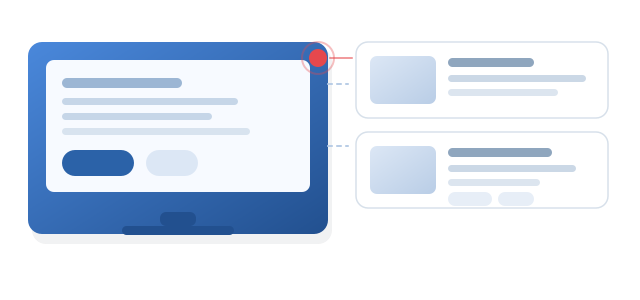

# 屏幕纪事 · Screen Trail

DeepSeek Harness 的本地屏幕纪事插件：定期观察屏幕，由模型把一段时间内的画面整理为可回顾的活动记录，而不是为每张截图生成一条浏览历史。



## 能做什么

- 按自定义时间间隔采样主屏，默认每 5 秒一次，并过滤重复画面。
- 默认每 5 分钟选取最多 20 张代表图，交给支持图片输入的模型分析。
- 由模型自主判断创建、延续、合并或忽略事件，不按应用切换机械拆分记录。
- 通过日期 Tab 切换每天的事件，查看封面和截图依据，在 Harness 原生会话中查看分析及工具结果。
- 在宿主权限允许时，通过 `screen_trail_find_events` 和 `screen_trail_write_events` 查询、编辑历史事件。

## 环境要求

- macOS，以及可加载本插件的 DeepSeek Harness。它不是独立应用，也不需要单独启动 Screenpipe 服务。
- 本机 Swift 编译器，用于首次使用时编译 ScreenCaptureKit 采集辅助程序。
- macOS“屏幕录制”权限，以及 Harness 中已配置的图片输入模型。

插件需要 Node.js 24 或更新版本（使用内置 SQLite，无外部数据库依赖）。目前 CI 使用 Node.js 24 和 Apple 芯片 macOS 15；其他环境不在当前 CI 验证范围内。

## 安装与使用

本项目通过 `package.json` 声明 Harness 插件入口和 bundle 配置。可在仓库根目录生成本地安装包，再通过 Harness 支持的插件安装流程加载：

```sh
npm pack --ignore-scripts
```

加载插件后：

1. 打开 Harness 侧栏的“屏幕纪事”面板。
2. 按需选择模型、思考强度及采样间隔，保存设置。
3. 点击开始记录，按系统提示授予屏幕录制权限，然后切换到实际工作的窗口。
4. 等待一批分析完成后查看事件；也可使用“立即分析”提前整理已有候选。
5. 不需要继续观察时，点击停止。

默认不自动开始采集。纪事面板自身会被排除，普通 Harness 聊天窗口不会因属于同一应用而被整体排除。

## 默认配置

```yaml
sampleIntervalSec: 5
analysisWindowSec: 300
analysisMaxTokens: 16384
analysisReasoningEffort: low
retention: 80
autoStart: false
```

采样间隔与分析周期相互独立。页面保存的采样间隔和模型设置会保留到重启后，并优先于初始插件配置。模型必须支持选定的思考档位，不支持时明确报错。

## 数据与隐私

当前版本使用 SQLite 存储，图片仍独立保存：

| 路径 | 内容 |
| --- | --- |
| `~/.dsh/screen-trail/journal.sqlite` | 事件、观察记录、证据关联、插件设置和分析会话关联 |
| `~/.dsh/screen-trail/shots/` | 按内容哈希共享的 JPEG 截图 |
| `~/.dsh/screen-trail/diagnostics/` | 最近分析的本地诊断文件 |
| `~/.dsh/screen-trail/native/` | 编译后的采集辅助程序缓存 |

正式事件长期保留，不再按 80 条淘汰；临时观察默认保留 80 条，待分析观察另有容量控制，事件引用的证据不会被误删。面板默认展示今天，日期 Tab、左右导航和日期选择器按 Asia/Taipei 切换日期；每页 30 条，可加载更多。跨天事件归开始日期，结束时间显示完整日期。

**升级到 0.7.0 的首次加载会清空旧 JSON 历史、截图和诊断，不迁移事件。** 保留已保存的采样间隔、模型设置及宿主聊天；新库后续分析新建会话，不复用含旧事件 ID 的关联。数据库初始化或清理失败明确报错，不退回 JSON。普通“清空”操作保留用户设置和原有聊天关联。

原始截图保存在本机，但选中的代表图及应用、窗口信息会发送给你配置的模型服务；分析会话和附件也由 Harness 按其自身规则存储。不能把“本地采集”理解为“所有数据都不离开设备”。诊断文件可能包含输入、回复和窗口标题，分享前应检查敏感信息。

不录制音频或全天视频，不做 OCR，不读取辅助功能正文，也不监听按键或剪贴板。清空插件数据不等于删除 Harness 的聊天会话或附件副本。

## 开发与文档

```sh
npm test
```

测试使用模拟屏幕和模型，不调用真实云端模型或实际录屏；通过测试不代表模型的事件判断一定准确。

- [中文详细说明](docs/DETAIL.zh.md)：采集、选图、上下文管理、权限、配置和错误诊断。
- [English Details](docs/DETAIL.md)

数据库写入与证据关联使用事务；状态轮询不携带全量事件，日期列表通过独立接口按需分页读取。
