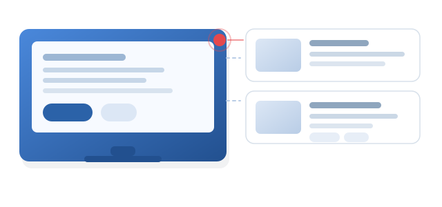

## Simplified Capture (0.6.1)

A persistent macOS ScreenCaptureKit stream samples the primary display at a configurable interval, defaulting to once every five seconds. Enter a positive integer number of seconds in Sampling Interval; Enter or blur saves it across restarts. Changing it rebuilds capture without cancelling analysis. Idle messages extend presence without re-encoding images. There is no OCR, accessibility-body extraction, DOM parsing, input monitoring, audio or all-day video recording. Only application/window identity is read.

Simple RGB filtering removes near-duplicate candidates. JPEG files share SHA-256 content IDs, but A-to-B-to-A remains three raw occurrences. Every five minutes, up to twenty representative frames are selected by time alone: retain the first and last, then choose the nearest unselected candidate to each evenly spaced target between them, breaking ties toward the earlier candidate. New windows/resources, manual triggers, context switches, dwell time and visual change do not receive selection bonuses. Send all candidates when within budget and preserve chronological order. Capture deduplication is unchanged; brief switches remain eligible but are not guaranteed selection. The budget scales with the configured interval from six to twenty. Identical images upload once.

The model receives only selected representative images and their numbers, readable Asia/Taipei dates and window metadata, excluding bundleId. Full timelines, saved-state snapshots and selection explanations are not sent. Unselected candidates have not been judged by the model. Stored times remain milliseconds.

The prompt asks for a useful journal rather than a page-by-page browsing history. The model chooses what to keep, continue, merge or omit, including an empty batch. There are no classification labels, scores, duration gates or extra interpretation calls. Visibility does not establish attention, reading, understanding or completion. Capture, selection budgets, stored history and UI are unchanged. Goals, progress, details and tags are optional; text arrays are no longer silently reduced to three details or five tags.

Use write_events with create/update/merge/delete actions and real IDs from tool results or find_events. mergeIds names the other events to consolidate. Screenshot numbers remain local to the batch. Existing descriptions can be updated without new images. Retained IDs and positions remain stable. There is no implicit same-label/window merge, deferred pool, undo or startup bulk rewrite.

Unused candidates are removed after successful analysis; the program does not add its own value filter. Unreferenced local JPEGs are collected; shared evidence survives. Partial image assignments and empty arrays are allowed. Invalid IDs, missing labels/summaries and invalid merge/cover contracts fail visibly, retaining evidence rather than treating protocol errors as deliberate omission.

The main list shows goals with expandable phase details and evidence. The model picks a meaningful main cover or keeps the old cover for supporting work. Capture Evidence shows pending/failed candidates and retained assigned observations. Analyse Now can run early on queued images; it does not capture the recorder page.

## Self-Surface Exclusion

The visible panel marks its window title with `[dsh-screen-trail]`; hiding or unmounting removes the marker. Native capture excludes a focused marked window before encoding and persistence. Ordinary Harness chat remains eligible. Start observing, then switch to another window.

## Screen Sleep and Wake

Screen sleep, system sleep or loss of a capture source pauses capture while retaining the helper, existing data and analysis. The UI shows a waiting state. About one second after the display wakes, the controller restarts the helper once to obtain a fresh primary display and stream. Background system wakes do not trigger recording; duplicate display-wake notifications do not start multiple helpers.

Manual pause cancels pending recovery. Failed recovery, user-stopped sharing, permission errors and other capture failures remain explicit errors with native domain/code diagnostics. There is no retry loop, capture fallback or dedicated monitor-hotplug handling. Mock lifecycle tests and the helper's `--self-test-screen-events` exercise the notification path without actually sleeping the display, capturing pixels or requesting Screen Recording permission. Real sleep/wake still requires device verification.

## Native Analysis Conversations

Each batch is submitted through a real Harness Agent conversation. Harness streams and persists the actual input, tool calls and results. Events are saved by the two local business tools, not by parsing final chat text. Conversations belong to a dedicated 屏幕纪事 group. No general file, terminal or network tools are opened.

The native Workspace registry creates or reuses the group for the plugin's existing `~/.dsh/screen-trail` directory. New analysis sessions are created there and explicitly attached. Shared profile directories and unrelated conversations are not grouped, and user-renamed group titles are preserved. Registration or attachment failures remain explicit errors rather than ungrouped fallbacks.

For legacy sessions created elsewhere, the next analysis opens a fresh conversation in the dedicated group. Old conversations stay where they were: no moving, copying, archiving, deleting or header rewriting. Saved journal events remain untouched and can be queried, but old chat history is not copied. The normal eight-hour reuse policy applies within the dedicated group.

Reuse the current conversation until eight hours have elapsed since its latest user or assistant message. Only the next analysis opens a new conversation; midnight alone does not rotate it. Manual messages reset the gap, title/config events do not. Persist the association across restarts, retain old conversations, and keep empty event replies visible. Missing, busy or failed native conversations produce explicit errors rather than invisible direct-model fallbacks. Clearing recorder data does not remove host conversations or reset the association.

The per-batch image budget is unchanged. Conversation history, native compaction and total model context follow Harness's standard behavior; the batch image limit is not a lifetime history limit.

## Harness-Owned Context

There is no recent-eight selector, exact-image return lookup, twelve-candidate history cap or plugin summarizer/retrieval flow. Native Harness history and its enabled compaction/image-handling components own conversational context. The installed base bundle includes those components; host overrides remain authoritative and the plugin does not replace a disabled backend.

Before publishing a new Agent or submitting analysis, mount the host's current default Agent preset and store its ID in the session header. Resume reads the latest native preset projection and remounts that selection, not a changed default. Web Harness owns automatic compaction inside the preset's isolated group: creating a raw Agent is insufficient, and ordinary `agent.ctx.get('compaction')` does not see that group. Query the bound composition through `agentPresets.serviceFor()` instead.

Unresolvable presets, mount failures, missing compaction or disabled native automatic compaction explicitly stop analysis and preserve pending evidence. There is no raw-agent fallback, local summarizer, history truncation or new time/token threshold. Host policy still owns automatic compaction, image-history handling and overflow recovery; the plugin does not invoke compaction or retry failed batches itself. Native summaries may make additional model calls beyond the main analysis-request counter.

A legacy associated conversation with no recorded preset stays untouched; the next analysis opens a properly composed conversation without copying history or clearing saved journal events. Current business-state inputs, the dedicated group and the eight-hour rollover remain unchanged. A UI-owned live Agent that lacks its recorded composition is rejected rather than silently reconfigured.

Two global native tools replace parsing final chat JSON and are available to every DSH conversation subject to host permissions: `screen_trail_find_events` queries compact records by keywords, date range or IDs (ten by default), optionally returning cover images or stored evidence IDs. `screen_trail_write_events` creates, updates, merges or deletes, returning real IDs and actions. Analysis uses current image numbers; ordinary chat can attach stored screenshots through evidenceIds. Existing IDs stay stable and unspecified update fields are preserved; new events require screenshot evidence.

Each call is validated on a copy and committed through the serialized atomic state-file writer before publication. Replaying the same tool call reuses its receipt; new calls in the same turn may make further edits. The plugin does not call concludeTurn(): the model receives the result and can inspect, edit again or reply normally, potentially making additional model requests. Later model/chat-persistence failures are reported separately and cannot undo or requeue committed events.

Tools, capture and UI share the existing service and state.json. No separate service or database is added. There is no plugin tool allowlist, file/terminal/network ban or executor override: DSH's own preset, approvals and security policies remain authoritative. Neither analysis nor ordinary chat writes force a turn conclusion. Candidates remain available until the turn finishes, so later edits can still use their images; unused candidates are reclaimed only at the end of a committed turn. Failed uncommitted batches retain evidence. Old records are not rewritten at startup; new conversations can query current records instead of receiving full snapshots.

## Permissions

The first launch compiles the helper using a local Swift compiler and caches it under `~/.dsh/screen-trail/native/`. Grant Screen Recording to DeepSeek Harness or the helper named by macOS. Accessibility and Input Monitoring are not required. Failures are visible; there is no silent switch to the old capture mode. Screenpipe and FFmpeg are not dependencies.

## Storage and Backpressure

Version-four `state.json` separates raw observations and activities. Existing history migrates without clearing. Shared JPEGs live under `shots/`. By default, 80 processed raw observations and 80 activities are retained. Pending observations have a separate capacity. Each activity keeps at most twelve evidence frames: its first, chosen cover and recent evidence. Referenced images survive observation pruning.

Only one frame is processed and one stream frame may wait; superseded waiting frames are counted and logged. Pending capacity is the ceiling of (analysis window plus ninety-second timeout) divided by the sampling interval, and is never smaller than history retention. At the five-second default, capacity is 80 with a 74-frame resume watermark. Capture pauses at capacity while analysis drains. User pause stops both; Analyse Now can process remaining candidates. Clearing removes plugin-owned data, preserving helper binaries and configuration. Host-managed attachments have independent retention; local collection does not delete those copies.

The latest 50 diagnostics preserve native session/batch/selected/saved-event IDs, decisions, model controls, finish reason and usage, plus the plugin's prompt, new batch state and raw reply. `contextOwner: harness`, `agentPreset`, `compactionAvailable` and `compactionAuto` describe the bound composition, not proof that compression occurred. `contextBefore`/`contextAfter` are native Token Meter measurements of the current session; the former excludes the new batch and capacity may be unknown before its first request, so their difference is not compression savings. Actual `compaction/start`, `summary` and `end` events populate `compactions` with phase measurements, shadowed token counts and errors, never summary text. Harness's canonical conversation owns the full native request/history. Private batch input/replies stay in restricted local files, not polling state or ordinary logs. No extra image copies, credentials or full reasoning text are duplicated. Protocol errors are not repaired or automatically retried by this plugin.

Defaults: `sampleIntervalSec: 5`, `analysisWindowSec: 300`, `analysisMaxTokens: 16384`, `analysisReasoningEffort: low`, `maxDimension: 1600`, `retention: 80`, `autoStart: false`. The bundle explicitly requests low reasoning; an unsupported effort fails rather than silently degrading. Sampling and analysis intervals are independent; the saved UI choice takes precedence over initial sampling configuration. Other old event-trigger timing settings are retired with a migration log. Optional model controls remain supported.

The panel provides model and reasoning selectors with explicit Save. Models come from DSH's active providers and reasoning choices from the selected model's metadata; declared text-only models are excluded. Host-model following and model-default reasoning are available. Unsupported reasoning is shown rather than silently replaced. Saved settings persist in the existing state.json, override initial plugin config, and affect the next analysis without interrupting the running one or changing DSH's global defaults. Refresh reloads metadata; errors remain visible. No generation is performed by configuration endpoints.

Run `npm test`. Tests inject frames, storage and responses, including a host-provided compacted-history contract fixture; they do not perform real model compaction or prove judgment accuracy. Evaluate real blank pages, brief PDF appearances, sustained static viewing and short important results separately. Actual recording and model quality require authorised verification.

## Simple CI

Pushes, pull requests and manual dispatch run one Node.js 24 / Apple Silicon macOS 15 job: unit/package checks, Swift compilation, native no-capture self-tests, then an installable package artifact. Failures block later steps; reports upload on test failure. No Ubuntu, additional Node versions or Intel matrix is run. `npm test` still runs all existing test files without recording or real model calls.

The fixture reads the current observation-only input and checks date formatting, removed fields, uniform selection and sampling intervals. `fixtureActivities` is test-only data for scripted update/merge replies, never model-visible input; these checks do not prove autonomous model association when activity IDs are absent.
