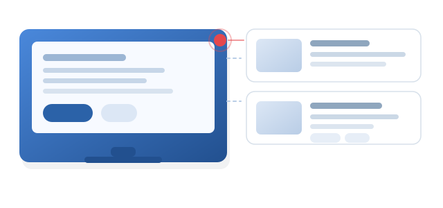

## 简版采集规则（0.6.1）

使用 macOS ScreenCaptureKit 持久画面流按采样间隔观察主屏，默认每五秒一次。页面“采样间隔”可输入任意正整数秒，回车或离开输入框保存；修改会重建采集流，不中断当前分析，重启后保留选择。系统报告画面未变化时只延长停留时间，不重新编码截图。没有逐帧外部截图/转换命令，也不录制音频或全天视频。

只读取应用名、窗口名和窗口身份，不读取 AX 正文，不做 OCR、网页解析或按键监听。RGB 缩略图用于简单重复过滤；图片文件按 JPEG 内容的 SHA-256 指纹共享。同图重复停留不新增观察，A→B→A 的发生顺序仍保留。

## 每五分钟整理事件

默认收集五分钟观察，选最多二十张代表图：首尾必选，其余按首尾之间的等间隔目标时间，选择距离最近且尚未选中的候选；同距时取时间更早者。不因新窗口、新资源、手动触发、窗口切换、停留时长或变化幅度获得选图加分。候选未超过预算时全部发送，最终按时间排序，相同图片资源只上传一次。采集去重规则不变；短暂切屏仍可成为候选，但不保证入选。调整分析周期时，代表图预算随周期变化，最少六张、最多二十张。

模型在 Harness 原生会话中只接收本批代表图及其编号、日期时间和应用/窗口信息；不发送全量时间线、完整事件状态快照或选图说明，窗口信息不含 bundleId。模型输入时间使用 Asia/Taipei 的 `YYYY-MM-DD HH:mm:ss`；本地仍保存毫秒时间戳。没有入选的候选不会提供给模型，不能假设它判断过所有采集画面。

提示词只明确产品目标：帮助用户回顾实际开展的事情，不是逐页浏览历史或截图配文。模型自主选择保留、延续、合并或忽略，允许整批没有事件；插件不新增分类、评分、时长门槛或额外判别调用。原生压缩的摘要与溢出恢复请求仍由宿主决定。可见时间不等于注意力，页面内容不等于用户已经阅读、理解或完成；历史事件摘要也只是之前的模型推断，不作为已确认意图。

采集、选图预算、历史存储结构及界面不变。事件只要求标题、摘要和必要图片引用，`goal`、`change`、`details`、`tags` 可选，不强迫模型为已观察的事实编造明确目标；程序不按三条详情、五个标签等固定数量静默裁剪模型文本结果。不新增长期待定池。

A→B→A 是否属于同一任务由模型决定；通过业务工具更新 A 或合并旧阶段，不按同名任务、相同窗口或固定时长自动合并。没有新增待定池、撤销或复杂审核机制，也不在启动时批量重写历史。

模型未采用的候选在分析成功后直接从观察中移除，无引用的本地截图随即回收，不进入下一批待定；程序不额外替模型判断图片价值，失败批次保留证据供手动重试。遗漏部分图片或返回空事件数组都是合法结果；无效事件引用、缺少标题/摘要或无效合并/封面协议会报错，不把协议错误伪装成“模型决定忽略”。

主列表展示事件，详情展开阶段和截图依据。模型为事件选择有意义的主画面作为封面；若新增证据只是辅助步骤，可保留原封面。下方“采集证据”展示待分析、失败及实际归入事件的原始观察。点击“立即分析”可提前处理现有候选，不截取纪事页面。

## 排除自身回放

可见纪事面板给窗口标题加入 `[dsh-screen-trail]` 标记，隐藏或离开面板时移除。辅助程序在图片编码、落盘和模型请求前检查前台窗口标记并排除。普通 Harness 聊天页面不因应用名称相同而被排除。

开始记录后请切换到其他窗口。停留在纪事页面时面板显示排除提示，后台流保持运行，等待真实工作画面。

## 在 Harness 会话中查看分析

每次分析通过宿主原生 Agent 会话提交截图和本批上下文，真实模型回复及工具结果由宿主展示并持久化。事件由工具调用保存，不再解析最终聊天 JSON 来落库。会话默认位于“屏幕纪事”专属分组，不靠补写伪回复展示。

分组使用宿主原生 Workspace 注册表，对应插件已有数据目录 `~/.dsh/screen-trail`。加载时创建或复用分组，新分析会话在该目录创建并显式归组；不把共用的 profile 目录登记为插件分组，也不重命名用户已经改过的分组。分组登记或挂接失败会明确报错，不退回未分组分析。

按用户选择，旧版本绑定的会话若创建在其他目录，下次分析从专属分组中的新会话继续。旧会话留在原处，不搬移、复制、归档或删除，已保存的纪事事件也不改写。原生分组要求会话的创建目录匹配，因此这里切换后续分析的绑定，不修改旧会话头部。新会话仍按既有规则接收当前业务产物状态，不复制旧聊天历史。

不足八小时没有新消息时继续复用当前会话。距该会话最后一条用户或模型消息满八小时，下次分析才创建新会话；不是按自然日切换，也不会定时创建空会话。手动消息计入间隔，标题和配置变化不计入。关联的会话 ID 保存在插件状态中，重启后复用；旧会话不会因轮换而删除。

没有生成事件时，输入与原始回复仍保留在会话。无法创建、恢复或刷新会话时明确报错，不回退到不可见的后台模型请求。会话正在处理其他消息时，分析显式失败，保留候选供重试。插件清空采集数据不会删除 Harness 聊天或重置会话关联；会话历史由宿主单独管理。

每批新增代表图预算不变；真实会话的历史上下文、可能的历史压缩和模型输入总量由 Harness 原生会话机制处理，不把“每批最多二十张”解释为整个会话永远只有二十张。

## 上下文由 Harness 管理

插件不再按最近八条、相同截图回访或最多十二个历史候选拼接 `Recent activities`，也不自行生成历史摘要、判断压缩时机或实现检索流程。Harness 原生 Agent 负责提供会话历史；宿主已启用的自动压缩和图片历史处理按其原生策略运行。安装包的基础组合包含这些组件，用户覆盖配置后以实际宿主配置为准，插件不另做替代后端。

新会话在发布和提交分析前挂载宿主当前默认的 Agent 预设，并在会话头保存预设 ID；恢复时读取宿主投影中的最新选择并重新挂载，不因用户更改默认预设而悄悄替换旧会话的组合。Web 宿主把自动压缩放在预设内部的隔离组，不能只创建裸 Agent，也不能用普通 `agent.ctx.get('compaction')` 判断是否存在；本版通过 `agentPresets.serviceFor()` 查询实际绑定组合中的服务。

预设无法解析、挂载失败、压缩服务缺失或原生自动压缩被关闭时，明确停止本批分析并保留候选，不回退裸会话，不自行截断历史，不新加本地摘要或时间/token 阈值。预设的自动压缩、图片历史处理及溢出恢复按宿主既有策略执行，插件仍不直接调用压缩接口或自行重试失败批次。后台摘要可能产生宿主额外模型请求，不能把主分析请求计数解释为所有宿主调用的总数。

旧版已绑定但没有记录预设的会话，在下次分析时保留原处，并切换到挂载预设的新会话；不修改旧会话头、不搬移/复制聊天历史，也不清空已保存的纪事事件。新会话继续接收当前业务产物状态，仍归入“屏幕纪事”分组，八小时轮换规则不变。已被界面恢复但实际没有预设的 Agent 会明确报错，不擅自改造用户正在使用的实例。

插件全局提供两个原生业务工具，所有 DSH 会话均可在宿主权限允许时使用：`screen_trail_find_events` 按关键词、日期范围或 ID 查询当前库，默认返回最多十条简短事件；明确指定 `includeCover` 才附封面，指定 `includeEvidence` 可读取已有截图依据的 ID。`screen_trail_write_events` 支持 `create`、`update`、`merge`、`delete`。更新/合并使用真实 `id`，`mergeIds` 指其他被合并事件。自动分析可用本批图片序号，普通聊天可用 `evidenceIds` 引用已有截图。字段未提供时保留原值；新事件仍需标题、摘要和截图依据。

每次写入先在副本校验、按串行写队列原子替换状态文件，成功后发布新状态并返回真实事件 ID、标题、动作与被合并/删除 ID。同一个工具调用的重放复用回执，不重复创建；同一轮可发起新的工具调用继续查询、修改。插件不调用 `concludeTurn()`，模型收到工具结果后继续按 DSH 正常流程思考、操作或回复，因此可能增加模型请求轮次。已保存事件即使后续模型或聊天持久化失败也不会回滚或重新入队，诊断分别记录事件提交和后续失败。

采集、页面接口和工具共用现有服务及 `state.json`，不新增 HTTP 服务、MCP 服务或数据库。插件不再增加工具白名单或禁止文件、终端、网络等宿主能力，不替换宿主执行器，也不绕过 DSH 自身的预设、权限审批与安全策略。自动分析和普通聊天的写入均不强制结束本轮；空变更可确认本批无需记录，但模型仍能继续调整。分析候选保留至整轮结束，供后续工具调用继续引用；已提交批次在整轮结束后统一回收未采用的候选，未提交失败批次保留证据。

新会话或压缩后可按需查库，不恢复全量状态快照，不自行复制旧聊天，不自动批量合并旧记录。原始截图不因摘要修改而改写；旧事件 ID 和存储版本无需迁移。

## 熄屏与恢复

熄屏、休眠或系统报告采集源不可用时，暂停采集并保留辅助进程，界面显示“等待屏幕恢复”；已有数据和分析流程不因此清空或停止。屏幕重新亮起约一秒后，只重启一次采集辅助进程，重新获取当前主屏并建立录屏流，不复用失效的显示器对象。

后台系统唤醒不触发恢复；重复亮屏通知不重复启动。用户主动暂停会取消待执行的恢复，不能亮屏后自行录屏。恢复失败、用户停止共享、权限或其他采集错误仍明确报错，保留系统错误域和错误码，不无限重试，不切换采集方式。本版不专门处理显示器拔插。

开发验证包含模拟生命周期测试和辅助程序 `--self-test-screen-events`；后者只在自身进程发送测试通知，不实际熄屏、截屏或请求录屏权限。真实休眠/亮屏仍需在用户设备上验证。

## 权限与安装

首次使用需要本机 Swift 编译器。辅助程序按源码指纹编译并缓存于 `~/.dsh/screen-trail/native/`，不需要单独安装 Screenpipe 或 FFmpeg。

启动时由 macOS 请求“屏幕录制”授权，请允许 DeepSeek Harness 或系统列出的辅助程序；按系统要求重新开始记录或重启应用。简版不要求“辅助功能”和“输入监控”。编译、权限和原生协议失败都明确显示，不自动退回旧的截图模式。

## 数据与预算

`~/.dsh/screen-trail/state.json` 版本 4 分开保存原始观察与活动；`shots/` 保存共享 JPEG。旧版本历史迁移保留，不主动清空。分析后的原始观察与事件默认各保留八十条；待分析观察另用独立容量。每条事件最多保留十二张依据，包含首张、选定封面和最近证据；原始观察被回收后，事件仍引用的截图不会误删。

流帧在进程间传递，不使用复杂历史缓冲；后端最多一个正在处理的流帧和一个等待帧。写盘来不及时替换等待帧，日志和统计记录合并次数，不宣称所有瞬态都能保留。

待分析容量按“（分析窗口＋九十秒请求超时）÷采样间隔”向上取整，且不低于历史保留条数；默认每五秒一次时容量八十条、恢复水位七十四条。达到容量时只暂停采集，分析继续。手动暂停仍同时停止采集和分析，剩余候选可用“立即分析”处理。

清空会停止任务，删除插件拥有的观察、事件、截图与诊断，保留辅助程序和配置。宿主附件服务可能另有存储副本及自己的保留策略；忽略或清空本地截图不等于删除宿主附件。

## 错误诊断

沿用结束原因和输出用量检查：`max-tokens`、缺少结束事件、无效 JSON 都不能当成功；失败不自动重试，不修补残缺 JSON。

最近五十次诊断在 `~/.dsh/screen-trail/diagnostics/`，包含请求 ID、原生会话 ID、批次观察 ID、选中 ID、当前事件 ID、归属/合并决定、模型、预算、结束原因和用量。`contextOwner: harness` 标识上下文归属；`agentPreset`、`compactionAvailable`、`compactionAuto` 记录实际绑定的预设及内部压缩服务状态，不把“可用”当作“已发生压缩”。`contextBefore`/`contextAfter` 是宿主 Token Meter 对本轮前后当前会话的测量，前者尚未包含本批新增输入，首次请求前窗口容量可能未知；不是简单相减就等于节省量。真实 `compaction/start`、`summary`、`end` 被记入 `compactions`，含每阶段测量、被遮蔽 token 数及失败原因，不复制摘要正文。保存插件提供的提示词、本批时间线、业务状态及原始回复；原生会话实际携带的历史、系统上下文与完整请求以宿主记录为准。不复制完整会话、API 密钥、完整推理或额外截图。批次输入/回复只保存在权限受限的本地诊断文件，不放入轮询状态或普通日志；其中窗口标题等信息仍可能涉及隐私。普通日志用 `[screen-trail]` 标记各关键节点。

## 配置

```yaml
sampleIntervalSec: 5
analysisWindowSec: 300
analysisMaxTokens: 16384
analysisReasoningEffort: low
maxDimension: 1600
retention: 80
autoStart: false
```

`sampleIntervalSec` 是采样间隔，不是分析周期；页面保存的值优先于初始配置。安装配置明确设置 `analysisReasoningEffort: low`；模型不支持时明确报错，不静默降级。可选 `provider`、`model` 和 `locale`。其余旧事件触发参数已退役并记录迁移日志，不继续限制新链路。未配置思考强度或页面选择“模型默认”时，使用模型声明的默认档位；没有声明则不发送该选项。

页面可选择分析模型和思考强度，点击“保存模型设置”后下一批生效，不取消当前分析。模型列表取自 DSH 已注册提供方，已声明不支持图片的模型不展示；思考档位读取所选模型的实际能力，不凭空列出 low/high 等选项。也可选择“跟随宿主模型”和“模型默认”思考强度，后者使用模型声明的默认档位。切换模型不会静默替换不受支持的思考档位，需要用户明确选择兼容选项。页面保存的设置存入原有 state.json，重启后保留并优先于初始插件配置，不改 DSH 全局模型设置。“刷新模型”可重新读取目录；目录或能力读取失败会明确显示。

开发验证：`npm test`。测试注入屏幕与模型，不调用真实云端；包括宿主提供压缩后历史的契约回归，但不宣称真实触发了宿主模型压缩。时间线和回收测试不代表模型价值判断准确率。模型效果需用空白页、短暂 PDF、持续静态查看、短暂重要结果等真实片段复测。实际覆盖和资源占用需在授权后验证，简版不承诺完整录像级回放。

## 简版 CI

推送、Pull Request 或手动触发时，仅在 Node.js 24 + Apple 芯片 macOS 15 上运行一个任务：单元与打包边界检查、Swift 编译、原生无录屏自测，然后生成可下载的安装包。失败仍阻止后续步骤，不使用跳过断言或忽略错误来变绿；测试报告在失败时也上传。暂不重复运行 Ubuntu、其他 Node 版本或 Intel Mac。`npm test` 仍运行全部现存测试，不调用真实模型或录屏。

测试桩按当前 `Observations in time order` 读取输入，检查日期格式、移除的字段、均匀选图与采样间隔。用于构造更新/合并回复的 `fixtureActivities` 只是测试侧固定数据，不属于模型收到的内容，不证明模型在缺少事件 ID 的上下文中能自主完成关联。
